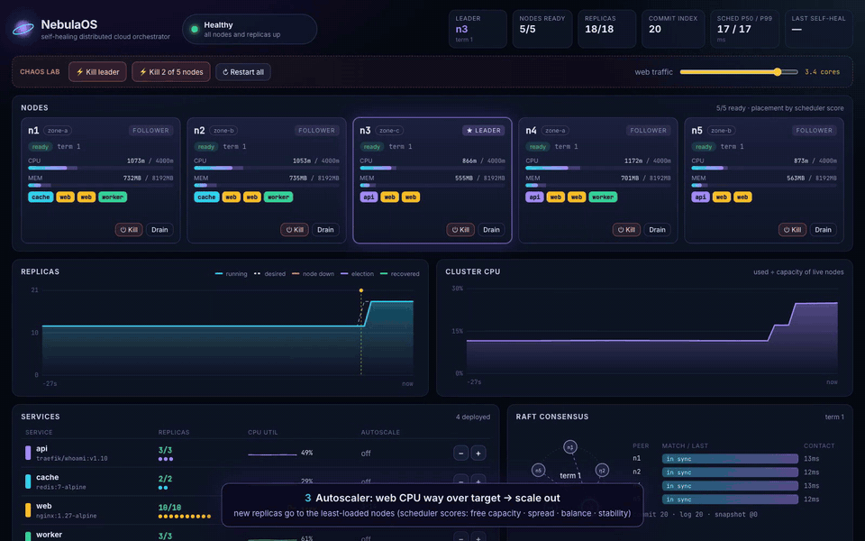
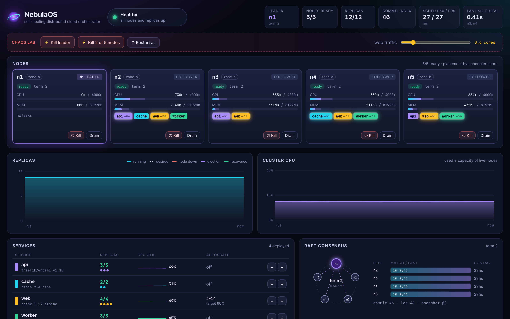
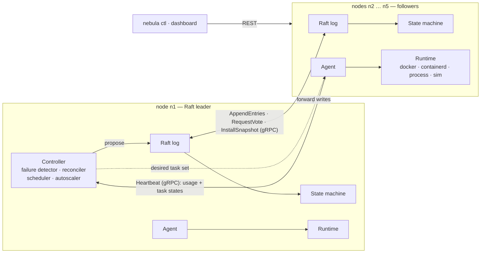
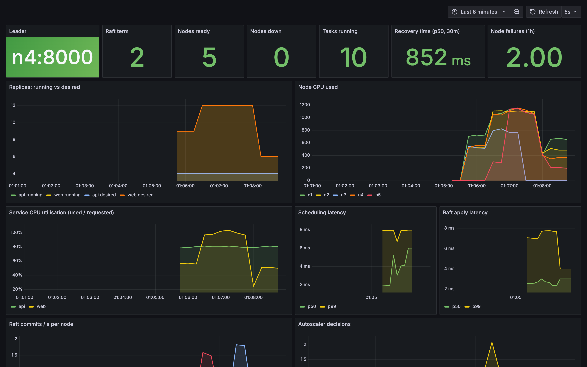

<div align="center">


# NebulaOS

### Self-healing distributed cloud orchestration platform — a small Kubernetes, built from scratch in Go

**Raft consensus written from zero · custom scheduler · failure detection & automatic rescheduling · HPA-style autoscaling · gRPC · Docker / containerd · live React dashboard · Prometheus + Grafana**

[](https://github.com/coolstack-coder/NebulaOS-Build-Your-Own-Distributed-Cloud-Operating-System/actions/workflows/ci.yml)


</div>

---

## 🎬 Demo

> Five real node processes. A traffic spike triggers the autoscaler. Then the **Raft leader and a second node are `SIGKILL`ed** — the survivors elect a new leader, detect the dead machines, reschedule every workload and record how long it took. The machines come back and rejoin; traffic drops and the cluster scales in; a node is drained for maintenance.

<!-- video -->

<p align="center">
  <a href="docs/media/nebulaos-demo.mp4"></a>
  <br/><sub>▲ The failover moment (GIF, 17 s). <b><a href="docs/media/nebulaos-demo.mp4">Full 2-minute walkthrough (MP4)</a></b></sub>
</p>

## Why this project exists

Kubernetes is the operating system of the cloud, but most engineers only ever see its YAML. NebulaOS rebuilds the core ideas end-to-end, so every step from *"run 3 replicas"* to *"a machine died at 3 a.m. and nobody had to wake up"* is code you can read:

| | What NebulaOS does | Where |
|---|---|---|
| 🗳️ **Distributed consensus** | Raft written from scratch: leader election with **pre-vote**, log replication with fast conflict backtracking, **check-quorum**, durable CRC-checked log, **snapshots** + `InstallSnapshot`, leader **group commit** | [`internal/raft`](internal/raft) |
| 🧠 **Custom scheduler** | kube-scheduler-style **filter → score**: capacity, readiness and label filters; least-allocated, balanced, replica-spread and node-stability scorers | [`internal/scheduler`](internal/scheduler) |
| 💀 **Failure recovery** | Heartbeat failure detector → node declared down → tasks marked lost → replacements created & rescheduled on healthy nodes → recovery time measured and recorded | [`internal/controller`](internal/controller) |
| 📦 **Container orchestration** | Deploy, scale, restart (in place, exponential backoff), drain, delete — on **Docker**, **containerd** (via nerdctl), native processes in **Linux namespaces**, or a simulator | [`internal/runtime`](internal/runtime), [`internal/agent`](internal/agent) |
| 📈 **Automatic scaling** | Kubernetes HPA algorithm: `ceil(replicas × utilisation / target)` with a tolerance band and a scale-down stabilisation window | [`controller.go`](internal/controller/controller.go) |
| 🛰️ **gRPC everywhere** | Protobuf contracts for Raft RPCs, agent heartbeats and write forwarding between nodes | [`proto/`](proto/nebula/v1) |
| 📊 **Live dashboard** | React + TypeScript, embedded in the binary: node placement, Raft ring & replication progress, replica/CPU timelines with failure markers, event log, chaos controls | [`web/`](web) |
| 🔭 **Monitoring** | Prometheus metrics on every node and a provisioned Grafana dashboard | [`deploy/`](deploy) |
| 🧪 **Chaos + benchmarks** | `nebula demo` kills real processes on demand; `nebula bench` measures election, detection and recovery times | [`internal/demo`](internal/demo), [`internal/bench`](internal/bench) |

<p align="center"></p>

## 📏 Benchmarks

Measured with `nebula bench`: a cluster of **5 separate OS processes** on one laptop (Apple M2, macOS), Raft log fsynced to disk on every commit. Failures are `SIGKILL`s — no graceful shutdown. Node timeout 2 s, heartbeat 300 ms, election timeout 500–1000 ms. Each scenario was run 5 times; raw runs in **[docs/BENCHMARKS.md](docs/BENCHMARKS.md)**.

**Failure recovery** — time from the kill until *every* replica of every service is running again:

| Scenario | New leader elected | Failure detected | **Full recovery (median)** | Worst run | Replica availability¹ |
|---|---|---|---|---|---|
| One follower crashes | — (leader survives) | 1.9 s | **2.47 s** | 2.55 s | 99.3 % |
| The Raft leader crashes | 0.57 s | 2.6 s | **3.19 s** | 3.21 s | 99.2 % |
| **Leader + a follower crash (2 of 5 nodes)** | 0.55 s | 2.6 s | **3.21 s** | 3.28 s | 97.4 % |

¹ mean share of desired replicas running during the 15 s after the kill.

**Control plane**

| Metric | Value |
|---|---|
| Cold start → leader elected | 681 ms |
| Scheduling latency (task created → bound to a node) | 6 ms |
| Deploy 20 replicas → all running | 561 ms |
| Replicated writes through the API (16 concurrent clients) | **730 ops/s**, p50 21 ms, p99 38 ms |
| Scheduler placing 500 tasks on 50 nodes (Go benchmark) | 2.3 ms |
| Real Docker containers: leader + follower killed → containers recreated | < 1 s after detection |

**Where the time goes:** recovery ≈ failure detection (bounded by `--node-timeout`, plus an election when the leader dies, because a new leader gives every node a fresh timeout) + one Raft round trip to reschedule + one heartbeat for the agent to start the task. Detection dominates *by design* — Kubernetes waits 40 s by default for the same decision. Lower `--node-timeout` and NebulaOS heals faster, at the cost of false positives on a flaky network.

Two things these numbers taught me while building it (both are in the commit history):
* The first version fsynced every Raft entry on the leader under its lock: **265 writes/s**. Switching to **group commit** (append to page cache, a persister goroutine fsyncs batches, the leader counts itself toward quorum only up to its durable index) tripled it.
* gRPC's default reconnect backoff grows towards 2 minutes, so a rebooted node stayed invisible to the leader for ~10 s. Capping backoff at 1 s brought rejoin under a second.

## 🏗️ Architecture



* **One binary, every role.** Voters run Raft + the state machine; whichever is leader also runs the controller. Every node runs an agent. Extra worker-only machines just `--join`.
* **No decision without consensus.** The scheduler, failure detector and autoscaler only *propose* commands; nothing takes effect until a majority has it on disk. A new leader picks up exactly where the old one died.
* **Deterministic state machine.** Task ids and timestamps are generated by the leader and travel inside the command, so every replica computes byte-identical state.
* **Level-triggered agents.** Each heartbeat response carries a node's *complete* desired task set — lost messages or restarts can't leave a node out of sync.
* **Fencing.** A node that was declared dead and comes back can't resurrect tasks that were already replaced elsewhere.

👉 **Deep dive: [docs/ARCHITECTURE.md](docs/ARCHITECTURE.md)** — Raft internals, on-disk format, the scheduling formula, the autoscaler, every failure mode, and a component-by-component comparison with Kubernetes.

## 🚀 Quick start

Requirements: **Go 1.26+** and **Node 22+** (only to build the dashboard). Docker is optional.

```bash
git clone https://github.com/coolstack-coder/NebulaOS-Build-Your-Own-Distributed-Cloud-Operating-System.git nebulaos
cd nebulaos
make build            # builds the dashboard, then the single bin/nebula binary
./bin/nebula demo     # 5-node cluster + sample services → http://127.0.0.1:9000
```

Open **http://127.0.0.1:9000** and use the *Chaos lab*: kill the leader, kill two nodes, drag the traffic slider to trigger the autoscaler, drain a node, power nodes back on.

### With real containers

```bash
./bin/nebula demo --runtime docker        # every replica is a real container
docker ps --filter label=nebula.node      # labelled with their node and task
```

### Five Linux containers + Prometheus + Grafana

```bash
docker compose up -d --build
open http://localhost:8082                # NebulaOS dashboard (any node serves it)
open http://localhost:3000                # Grafana → Dashboards → NebulaOS (admin / nebula)
docker kill nebula-n1 nebula-n2           # break it
docker compose start n1 n2                # heal it
```

<p align="center"></p>

### On real machines / VMs

```bash
PEERS=n1=10.0.0.1:7000,n2=10.0.0.2:7000,n3=10.0.0.3:7000
# on each control-plane machine (change --id and the addresses):
nebula node --id n1 --peers $PEERS --runtime docker --data /var/lib/nebula \
  --grpc 0.0.0.0:7000 --advertise-grpc 10.0.0.1:7000 \
  --api  0.0.0.0:8000 --advertise-api  10.0.0.1:8000
# extra worker-only machines just join:
nebula node --id w1 --join 10.0.0.1:7000,10.0.0.2:7000 --runtime containerd
```

## ⌨️ CLI

```console
$ nebula ctl status
leader:    n5 (term 2, commit index 28)
nodes:     3/5 ready
services:  4, replicas 12/12 running
scheduler: p50 24.0ms, p99 24.0ms
last self-heal: [n2 n4] recovered in 706ms

$ nebula ctl get nodes
NODE  STATUS  ROLE    CPU USED/CAP  MEM USED/CAP  TASKS  RUNTIME  ADDRESS
n1    ready   voter   752m/4000m    718MB/8192MB  4      sim      127.0.0.1:7701
n2    down    voter   0m/4000m      0MB/8192MB    0      sim      127.0.0.1:7702
n3    ready   voter   835m/4000m    625MB/8192MB  4      sim      127.0.0.1:7703
n4    down    voter   0m/4000m      0MB/8192MB    0      sim      127.0.0.1:7704
n5    ready   leader  751m/4000m    715MB/8192MB  4      sim      127.0.0.1:7705

$ nebula ctl get events
00:37:19.833  leader_elected   n5 elected leader for term 2
00:37:21.847  node_down        n2 marked down (no heartbeat for 2.0s); 2 task(s) lost
00:37:21.854  node_down        n4 marked down (no heartbeat for 2.0s); 3 task(s) lost
00:37:21.879  task_scheduled   api-6f8f0b rescheduled n2 → n5 (score 84)
00:37:21.879  task_scheduled   cache-025289 rescheduled n4 → n1 (score 87)
00:37:22.554  recovered        self-healed: all 12 replicas running again 706ms after [n2 n4] failed

$ nebula ctl deploy web --image nginx:1.27-alpine --replicas 4 --cpu 300 --mem 256 --autoscale 3:14:60
$ nebula ctl scale api 6
$ nebula ctl drain n2           # evict everything and cordon the node
$ nebula ctl uncordon n2
```

All commands: `nebula ctl help`. The REST API is the same one the dashboard uses (`GET /api/overview`, `POST /api/services`, `PATCH /api/services/{name}`, `POST /api/nodes/{id}/drain`, `GET /metrics`, …).

## 🧪 Testing

```bash
make test     # go vet + unit and integration tests
make race     # everything under the race detector, 3 times
make bench    # regenerate docs/BENCHMARKS.md
```

* **Raft** — one leader per term, re-election, in-order replication, *a minority can never commit*, snapshot catch-up for a lagging follower, restart from disk, torn-write recovery, and a **chaos test** that writes continuously while randomly partitioning a 5-node cluster, then asserts state-machine safety (every node's history is a prefix of one sequence) and that **no acknowledged write is ever lost**.
* **Scheduler** — spreading, never over-committing, filters, preference for idle and stable nodes.
* **Controller** — reconciliation, autoscaler scale-out, scale-down stabilisation (including right after a leader change), failure detector.
* **Integration** — three real nodes over gRPC on loopback: deploy through a follower, crash a node, crash the leader, verify everything lands back on the survivors.

## 📁 Layout

```
cmd/nebula/          single binary: node | ctl | demo | bench
proto/nebula/v1/     gRPC contracts (Raft + cluster API)
internal/raft/       consensus, storage, gRPC transport, chaos tests
internal/state/      replicated data model + deterministic state machine
internal/scheduler/  filter + score placement
internal/controller/ leader loops: failure detection, reconcile, schedule, autoscale
internal/agent/      node agent (the kubelet equivalent)
internal/runtime/    sim | process (+ Linux namespaces) | docker | containerd
internal/node/       wiring, gRPC services, write forwarding, REST API
internal/demo/       multi-process local cluster with chaos endpoints
internal/bench/      end-to-end benchmark harness
web/                 React + TypeScript dashboard (embedded with go:embed)
deploy/              Prometheus config, Grafana dashboard + provisioning
scripts/             Playwright script that records the demo video
docs/                architecture deep dive, benchmarks, media
```

## 🗺️ Roadmap

- [ ] Raft membership changes (add / remove voters at runtime)
- [ ] ReadIndex / lease-based linearizable reads
- [ ] mTLS between nodes and token auth on the API
- [ ] Service discovery + overlay network / L4 load balancing
- [ ] Rolling updates with health checks and automatic rollback
- [ ] Descheduler-style rebalancing after nodes recover

## 📜 License

MIT © [coolstack-coder](https://github.com/coolstack-coder)
