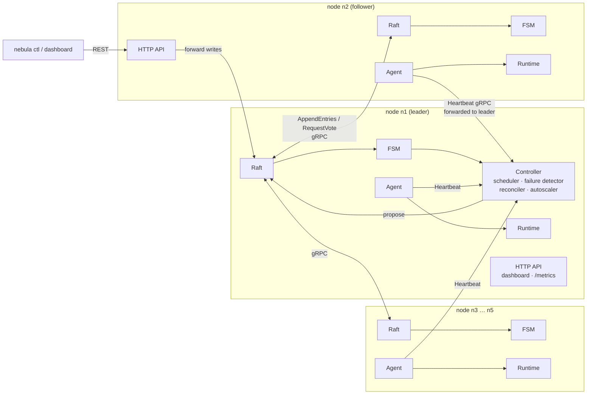
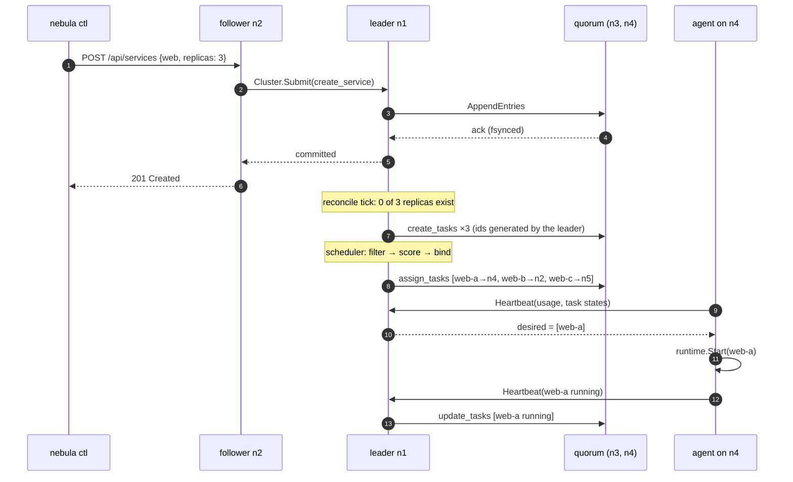

# NebulaOS architecture

This document explains how NebulaOS works, why it is built the way it is, and
where it deliberately cuts corners compared to Kubernetes. Code references
point at the files that implement each idea.

- [1. Goals](#1-goals)
- [2. The big picture](#2-the-big-picture)
- [3. Life of a deployment](#3-life-of-a-deployment)
- [4. Consensus: Raft from scratch](#4-consensus-raft-from-scratch)
- [5. The replicated state machine](#5-the-replicated-state-machine)
- [6. Leader control loops](#6-leader-control-loops)
- [7. The node agent](#7-the-node-agent)
- [8. Runtimes and isolation](#8-runtimes-and-isolation)
- [9. Failure modes](#9-failure-modes)
- [10. How this maps to Kubernetes](#10-how-this-maps-to-kubernetes)
- [11. Limitations and roadmap](#11-limitations-and-roadmap)

## 1. Goals

1. **Survive the loss of any minority of machines without a human.** With five
   control-plane nodes, any two can die — including the leader — and every
   workload must come back on the survivors.
2. **Every decision is durable before it takes effect.** The scheduler, the
   failure detector and the autoscaler never act on private state; they
   propose commands to a replicated log and only act once a majority has
   them on disk. A new leader can pick up exactly where the old one died.
3. **Make the internals observable.** Elections, replication progress,
   scheduling scores and recovery timings are visible in the dashboard, the
   event log and Prometheus.
4. **Small enough to read.** One Go binary, no external coordination service,
   about 6k lines of hand-written Go plus ~1.1k lines of tests (generated protobuf code not counted).

## 2. The big picture

Every process is the same `nebula` binary. A node listed in `--peers` is a
**voter**: it runs a Raft member, a copy of the state machine and — only
while it is the leader — the controller. Every node, voter or not, runs an
**agent** that heartbeats to the control plane and runs tasks through a
**runtime**. Worker-only nodes (`--join`) run just the agent.

| Package | Responsibility |
|---|---|
| `internal/raft` | Consensus: elections, replication, persistence, snapshots |
| `internal/state` | Cluster data model and the deterministic state machine |
| `internal/controller` | Leader-only loops: failure detection, reconcile, schedule, autoscale |
| `internal/scheduler` | Pure placement function: filter + weighted scoring |
| `internal/agent` | Per-node agent: heartbeats, converge runtime to desired state |
| `internal/runtime` | `sim`, `process` (Linux namespaces), `docker`, `containerd` |
| `internal/node` | Wiring, gRPC services, request forwarding, HTTP API |
| `internal/demo` | Local multi-process cluster + chaos endpoints |
| `internal/bench` | End-to-end benchmark harness |
| `web/` | React + TypeScript dashboard, embedded into the binary |

## 3. Life of a deployment

Two properties matter here:

* **Ids and timestamps are generated by the leader and stored in the
  command**, never inside the state machine. Replaying the same log on any
  node therefore produces byte-identical state (tested in
  `state/fsm_test.go: TestDeterministicApply`).
* **Agents are level-triggered.** A heartbeat response contains the *complete*
  set of tasks the node should run, not a diff. A lost message, a restarted
  agent or a leader change cannot leave a node out of sync for longer than
  one heartbeat.

## 4. Consensus: Raft from scratch

`internal/raft/raft.go` implements Raft as described in the
[extended Raft paper](https://raft.github.io/raft.pdf) and Diego Ongaro's
thesis. It is written from scratch rather than using `hashicorp/raft` or
`etcd/raft` so every step from vote to apply is visible.

### Elections

* Randomised election timeouts (`--election-timeout` to 2×) break symmetry.
* **Pre-vote** (thesis §9.6): before incrementing its term, a candidate asks
  whether peers *would* vote for it. Peers refuse if they have heard from a
  live leader within the minimum election timeout. A node that was
  partitioned away and comes back therefore cannot force a healthy leader to
  step down by showing up with an inflated term.
* **Election restriction** (§5.4.1): votes only go to candidates whose log is
  at least as up-to-date (last term, then last index).
* **Check-quorum**: a leader that has not heard from a majority within an
  election timeout steps down, so a leader on the minority side of a
  partition stops accepting writes instead of silently queueing them.

### Replication and commit

* One replicator goroutine per follower, at most one RPC in flight, batches of
  up to 256 entries. On rejection the follower returns a *conflict term* and
  the first index of that term, letting the leader skip a whole term per
  round trip (§5.3 optimisation) instead of one entry.
* **Commit rule** (§5.4.2, the Figure 8 problem): the leader only advances
  `commitIndex` to an index replicated on a majority *whose entry is from the
  current term*. Each new leader appends a no-op so that earlier entries get
  committed promptly.
* **Group commit.** The leader appends new entries to the OS page cache and
  signals a persister goroutine that fsyncs in batches. The leader may send
  entries to followers before they are durable locally (thesis §10.2.1) but
  only counts *itself* towards the quorum up to its own durable index.
  Followers fsync before acknowledging. This change raised replicated
  writes from ~265/s to ~730–790/s on macOS, where every fsync is a full
  `F_FULLFSYNC` to the platters (~3 ms).

### Persistence

| File | Contents | Write strategy |
|---|---|---|
| `state.json` | current term, voted-for | temp file + fsync + rename |
| `raft.log` | `[len u32][crc32c u32][protobuf LogEntry]` records | append; fsync per batch |
| `snapshot.bin` | `[index u64][term u64][crc32c u32][FSM JSON]` | temp file + fsync + rename |

On startup the log is scanned record by record and any torn record at the
tail (a crash mid-write) is truncated, so the next append starts on a clean
boundary (`storage_test.go: TestFileStorageSurvivesTornWrite`).

### Snapshots

After `--snapshot-every` applied entries the applier serialises the FSM and
compacts the log. A follower that has fallen behind the compaction point
receives the snapshot through `InstallSnapshot`. Restores are applied by the
same goroutine that applies entries, so the FSM never sees a snapshot and an
entry interleaved.

### How it is tested

`raft_test.go` runs clusters over an in-memory network that can cut any node
off. Beyond the basics (single leader, re-election, ordered replication,
minority cannot commit, snapshot catch-up, restart from storage) a **chaos
test** writes continuously while repeatedly isolating random pairs of nodes in
a five-node cluster, then asserts:

* *State machine safety*: every node's applied history is a prefix of the
  same sequence.
* *Durability*: every write that was acknowledged to a client is present.

Everything runs under the Go race detector in CI.

## 5. The replicated state machine

`internal/state` holds four collections — nodes, services, tasks, events —
and ten operations:

| Op | Proposed by | Effect |
|---|---|---|
| `register_node` | leader, on first heartbeat or return from `down` | node → `ready` |
| `set_node_status` | failure detector / operator | `down` or `draining` marks the node's active tasks `lost` |
| `create_service` / `update_service` / `delete_service` | API, autoscaler | desired state |
| `create_tasks` | reconciler | new `pending` tasks with leader-generated ids |
| `assign_tasks` | scheduler | `pending` → `assigned` on a `ready` node, else ignored |
| `update_tasks` | leader, from heartbeats | `running` / `failed`, **only if the reporting node still owns the task** |
| `remove_tasks` | reconciler | garbage-collect lost/failed tasks, scale down |
| `record_event` | controller | elections, recoveries (with measured duration) |

The ownership check in `update_tasks` is a simple **fence**: a node that was
declared dead and comes back cannot resurrect tasks that have already been
replaced elsewhere, and its next heartbeat response tells it to stop them.

## 6. Leader control loops

`internal/controller` runs every 100 ms on the leader, in this order:

1. **Failure detector.** Every heartbeat updates an in-memory `lastSeen`.
   A node silent for longer than `--node-timeout` is proposed `down`. A new
   leader has no history, so it gives every node a full timeout of grace from
   the moment it takes over — which is why a leader crash takes roughly
   *election time + node timeout* to detect.
2. **Flush task updates** batched from heartbeats into one `update_tasks`.
3. **Reconciler.** For each service: if active replicas < desired, create
   replacements (remembering which dead node each replaces); if more, remove
   the least valuable first (pending → assigned → running on the busiest
   node). Lost and failed tasks are garbage-collected.
4. **Scheduler** (`internal/scheduler`). Pure function over a snapshot:
   * *Filters*: node is `ready`; node selector labels match; requested
     CPU/memory fit in capacity minus already-allocated requests.
   * *Scores* (0–100 each, weighted): **least-allocated** ×3 (free capacity
     after placement), **balanced** ×1 (keep CPU and memory fractions close),
     **spread** ×4 (`100 / (1 + replicas of this service already there)`),
     **stability** ×2 (nodes that flapped within the last 30 s score lower).
   * Each placement updates the bookkeeping before the next task, so one
     batch can never overcommit a node. 500 tasks over 50 nodes take ≈2.3 ms.
5. **Recovery tracker.** After a node is declared down, the leader watches for
   the moment every service is back at its desired running count and records
   a `recovered` event with the measured duration.
6. **Autoscaler** (every 2 s), modelled on the Kubernetes HPA:
   `desired = ceil(running × avgUtilisation / target)` with a ±10 % tolerance
   band, clamped to `[min, max]`. Scale-up is immediate (3 s cooldown);
   scale-down only goes to the *highest* recommendation seen in a 15 s
   stabilisation window, which prevents flapping when load is noisy.

## 7. The node agent

Every 300–500 ms the agent (`internal/agent`) reports capacity, usage and the
state of each local task, and receives the full desired set. It then:

* starts tasks it doesn't have, stops tasks it shouldn't have, and pushes
  spec changes that don't need a restart;
* restarts crashed tasks **in place** with exponential backoff (1 s, 2 s,
  4 s … 30 s); after three consecutive failures it reports the task `failed`
  and the leader reschedules it on another node;
* on startup, reaps anything a previous incarnation left in the runtime.

Voters send heartbeats to their own server first, which forwards to the
leader; if that hop fails they try the other voters. The agent keeps running
its current tasks while the control plane is unreachable — a control-plane
outage is not a data-plane outage.

## 8. Runtimes and isolation

| Runtime | How | Use |
|---|---|---|
| `sim` | in-process model; each replica serves `demand / replicas` CPU, capped at 1.5× its request | demos and benchmarks: isolates control-plane timing from image pulls |
| `process` | `fork/exec` in its own process group; on Linux with `--isolate` as root, new **UTS, PID, mount and IPC namespaces** and `PDEATHSIG` so tasks die with their node | lightweight bare-metal workloads |
| `docker` | Docker CLI; containers labelled `nebula.node` / `nebula.task`; CPU and memory limits from the request | real containers |
| `containerd` | the same driver through `nerdctl`, containerd's Docker-compatible CLI | containerd hosts without dockerd |

Shelling out to the CLI keeps the dependency tree tiny and identical for both
engines; the cost (~10 ms per call) is noise next to container start time.
Status is refreshed right after `run` returns and then every second, with
`stats` sampled separately so a slow stats call never delays "running".

## 9. Failure modes

| Failure | What happens | Measured (5 nodes, `--node-timeout 2s`) |
|---|---|---|
| Follower crashes | Leader stops getting heartbeats → `down` after the timeout → its tasks `lost` → recreated and scheduled on survivors | detect ≈1.9 s, all replicas back ≈2.5 s |
| Leader crashes | Followers' election timers fire → pre-vote → new leader (≈0.55 s) → grace period → old leader declared down → its tasks rescheduled | new leader ≈0.57 s, recovered ≈3.2 s |
| Leader + follower (2 of 5) | 3 voters remain: still a majority, same as above | new leader ≈0.55 s, recovered ≈3.2 s, 97 % replica availability over the window |
| 3 of 5 voters lost | No majority: no leader, no writes. Agents keep running existing tasks. Cluster resumes when a majority returns | by design (CP system) |
| Leader partitioned into a minority | Check-quorum makes it step down; the majority side elects a new leader | covered by `TestMinorityCannotCommit` |
| Node returns after being declared dead | Re-registers on its first heartbeat; its stale task reports are fenced; it receives an empty desired set and stops old tasks; it becomes a placement target again (scored down for 30 s) | rejoin < 1 s |
| Crash mid-write to the log | Torn tail record detected by CRC and truncated on restart | unit tested |
| Task crash-loops | Restarted in place with backoff; after 3 failures reported `failed` and rescheduled elsewhere | — |

The numbers come from [`BENCHMARKS.md`](BENCHMARKS.md), produced by
`nebula bench` against real processes.

## 10. How this maps to Kubernetes

| Concern | Kubernetes | NebulaOS |
|---|---|---|
| Cluster state store | etcd (separate Raft cluster) | Raft embedded in every control-plane node |
| API | kube-apiserver, watch streams | REST + gRPC, followers forward writes to the leader |
| Leader election for controllers | Lease objects in etcd | the Raft leader *is* the controller |
| Scheduler | kube-scheduler: filter + score plugins | same shape: 3 filters, 4 weighted scorers |
| Node agent | kubelet, watches its pods | agent, level-triggered via heartbeat responses |
| Node failure detection | node-lifecycle controller, 40 s grace + 5 min eviction by default | `--node-timeout` (2–3 s by default) then immediate rescheduling |
| Autoscaling | HPA with stabilisation window | same algorithm, built in |
| Runtime | CRI → containerd / CRI-O | Docker / containerd via CLI, native processes, simulator |
| Networking | CNI, Services, kube-proxy | not implemented (see roadmap) |

Kubernetes' defaults are far more conservative because a false "node dead"
verdict on a real network is expensive. NebulaOS chooses aggressive
defaults to make recovery visible; both values are flags.

## 11. Limitations and roadmap

Honest list of what is *not* here yet:

* **Membership changes.** The voter set is fixed at start-up. Joint consensus
  or single-server changes (thesis §4) would allow adding voters at runtime.
  Worker-only nodes can already join dynamically.
* **Linearizable reads.** Reads are served from the local replica (or proxied
  to the leader for the dashboard). ReadIndex / lease reads would make every
  read linearizable.
* **Pipelined replication.** One in-flight AppendEntries per follower;
  pipelining would raise throughput on high-latency links.
* **Service networking.** No overlay network, service discovery or load
  balancing yet; containers publish ports on their host.
* **Security.** gRPC and HTTP are plaintext and unauthenticated. mTLS between
  nodes and token auth on the API are the next step before running on an
  untrusted network.
* **Rebalancing.** Like Kubernetes without the descheduler, nothing moves
  running tasks back onto a node that recovers; new placements favour it.
